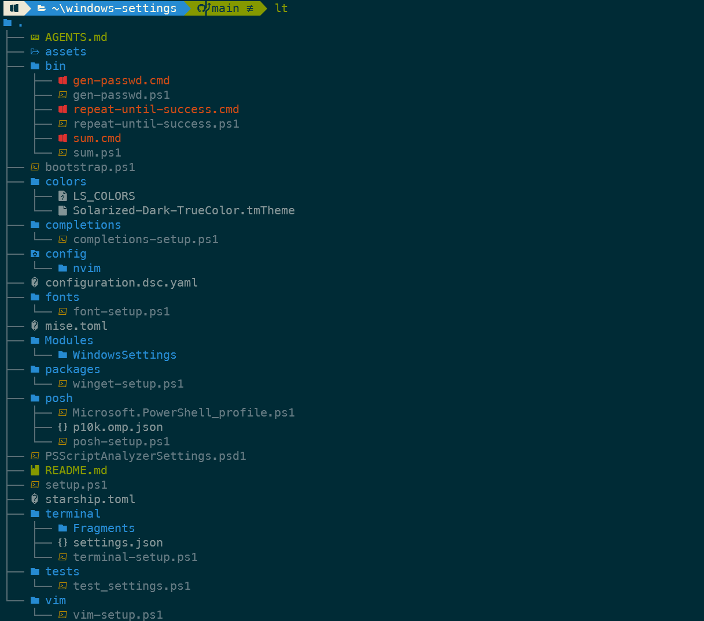
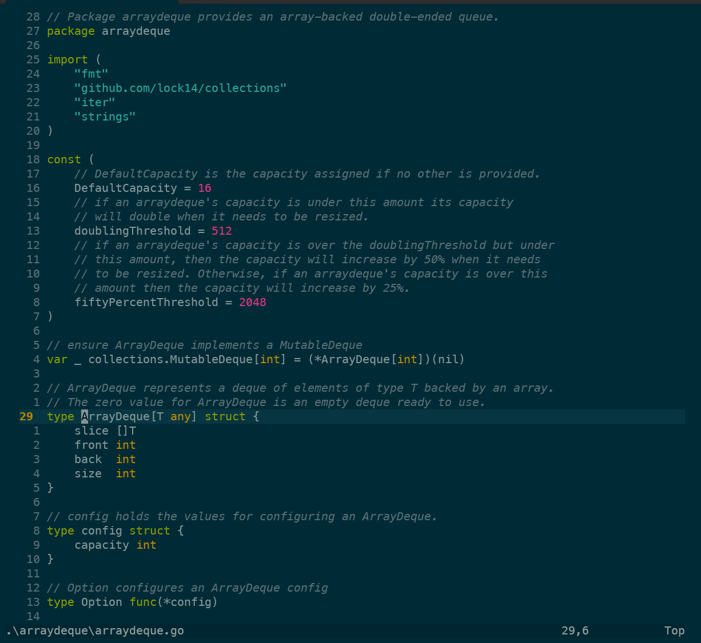

# windows-settings

[](https://github.com/lock14/windows-settings/actions/workflows/ci.yml)
[](https://github.com/lock14/windows-settings/actions/workflows/security.yml)
[](LICENSE)

Workstation setup automation, a self-describing 22-theme 24-bit TrueColor palette engine, a Zellij 0.46+ and Neovim Named Pipe RPC terminal IDE and AI agent fleet manager, and shell configurations for Windows 10 and Windows 11.

Host machines require PowerShell 7+ (`pwsh`), Git for Windows, Windows Terminal, and `winget`. Polyglot runtimes, language servers, and modern CLI utilities are managed declaratively via WinGet DSC (`configuration.dsc.yaml`) and [mise](https://mise.jdx.dev/) (`mise.toml`).

## Table of contents

- [Quick start and installation](#quick-start-and-installation)
  - [Turnkey bootstrap (new machines)](#turnkey-bootstrap-new-machines)
  - [Declarative WinGet configuration (Microsoft DSC v3)](#declarative-winget-configuration-microsoft-dsc-v3)
  - [CLI orchestrator (`setup.ps1`)](#cli-orchestrator-setupps1)
- [Command-line options (`setup.ps1` and `bootstrap.ps1`)](#command-line-options-setupps1-and-bootstrapps1)
- [Architecture overview](#architecture-overview)
- [Integrated development environment and AI workspace](#integrated-development-environment-and-ai-workspace)
  - [IDE workspace keybindings and navigation](#ide-workspace-keybindings-and-navigation)
- [Interactive shells and prompts](#interactive-shells-and-prompts)
- [Developer toolchains and modern CLI suite](#developer-toolchains-and-modern-cli-suite)
  - [Color theme management (`theme`)](#color-theme-management-theme)
- [Extensibility and customization](#extensibility-and-customization)
- [Git and shell shortcuts](#git-and-shell-shortcuts)
- [Standalone utilities (`bin/`)](#standalone-utilities-bin)
- [Development and testing](#development-and-testing)
- [Contributing, security, and license](#contributing-security-and-license)

## Quick start and installation

Provision a new machine via the single-command remote bootstrapper, apply the declarative Microsoft DSC manifest, or invoke `setup.ps1` directly with modular options.

### Turnkey bootstrap (new machines)

Stream and run directly in PowerShell 7 (`pwsh`) without pre-cloning:

```powershell
irm https://raw.githubusercontent.com/lock14/windows-settings/main/bootstrap.ps1 | iex
```

### Declarative WinGet configuration (Microsoft DSC v3)

Provision workstation packages declaratively via Microsoft DSC:

```powershell
winget configure .\configuration.dsc.yaml
```

### CLI orchestrator (`setup.ps1`)

Clone the repository and run `setup.ps1` to provision packages and user configurations, configure user-space dotfiles only, select an initial theme, preview changes in dry-run mode, or cleanly uninstall managed files:

```powershell
git clone https://github.com/lock14/windows-settings.git
cd windows-settings

# Full workstation setup (packages and user environment)
.\setup.ps1

# User-space configuration only (dotfiles, fonts, tools, shell, editor, terminal, and AI hooks)
.\setup.ps1 -User -Theme solarized-dark

# Preview actions without modifying system state
.\setup.ps1 -DryRun

# Remove deployed dotfiles, module, fragments, fonts, AI hooks, and PATH entries
.\setup.ps1 -Uninstall
```

## Command-line options (`setup.ps1` and `bootstrap.ps1`)

`setup.ps1` and `bootstrap.ps1` accept modular options to select scope, opt into desktop GUI applications, skip comma-separated stages, choose an initial color scheme, preview operations, or uninstall managed artifacts:

| Option | Default | Description |
| :--- | :--- | :--- |
| `(default)` | `enabled` | Full workstation provisioning: `winget` CLI packages, fonts, `mise` toolchains, themes, Neovim, shells, terminal, and AI hooks |
| `-User` | `disabled` | Configure user dotfiles, `bin/` `PATH`, fonts, `mise` toolchains, Neovim, terminal, shells, and AI hooks without `winget` system packages |
| `-SystemOnly` | `disabled` | Provision `winget` packages and system runtimes only |
| `-UseDSC` | `disabled` | Provision workstation packages using the declarative WinGet DSC manifest (`configuration.dsc.yaml`) |
| `-Uninstall [target,...]` | `disabled` | Remove managed artifacts: `all` (default when bare) or comma-separated `dotfiles,fonts,bin` |
| `-Gui [app,...]` | `none` | Install desktop GUI applications via `winget`: `all` (default when bare: `vscode,terminal,docker`) or comma-separated `vscode,terminal,docker,none` |
| `-Theme <slug\|holiday>` | `solarized-dark` | Apply initial TrueColor theme across all tools (`solarized-dark`, `dracula`, `rose-pine`, `holiday`, and others) |
| `-Skip <stage,...>` | `none` | Skip comma-separated provisioning stages: `packages,dotfiles,bin,fonts,tools,nvim,vim,posh,cmd,completions,terminal,hooks` |
| `-n, -DryRun` | `disabled` | Preview setup or uninstall actions without modifying the system |
| `-h, -Help` | `disabled` | Display CLI help and usage information |

## Architecture overview

<p align="center">
  
  <br>
  <em>Oh My Posh Powerline shelf prompt, predictive IntelliSense, and <code>eza</code> directory tree</em>
</p>

<p align="center">
  
  <br>
  <em>24-bit TrueColor syntax highlighting and Git gutter integration via <code>bat</code> (<code>b</code>)</em>
</p>

<p align="center">
  
  <br>
  <em>Lua Neovim in Solarized Dark with Native LSP, <code>render-markdown.nvim</code>, and Tree-sitter AST highlighting</em>
</p>

The repository separates declarative package manifests (`configuration.dsc.yaml` and `mise.toml`), thin provisioning entrypoints (`setup.ps1` and `bootstrap.ps1`) backed by modular stage scripts (`setup/`), standalone dual-execution executables (`bin/`) and their private PowerShell domain libraries (`libexec/`), declarative tool and theme configurations (`config/`), an autoloaded PowerShell module (`module/`), a Rust WASM Zellij top bar (`plugin/ws-bar/`), architectural specifications (`AGENTS.md`, `docs/`, and `.agents/`), and an automated verification suite (`tests/`):

```text
windows-settings/
├── configuration.dsc.yaml         # WinGet DSC v3 declarative machine configuration
├── mise.toml                      # Declarative polyglot toolchains, LSP servers, and CLI tools
├── bootstrap.ps1                  # Turnkey remote bootstrapper forwarding options to setup.ps1
├── setup.ps1                      # Modular provisioning CLI (-User, -Gui, -Skip, -Uninstall, -DryRun)
├── AGENTS.md                      # Concise root agent guardrails and component matrix (<24 KB)
├── llms.txt                       # LLM-oriented architecture and CLI index
├── CONTRIBUTING.md                # Contributor guide, multi-file contracts, and verification checklist
├── SECURITY.md                    # Vulnerability reporting policy
├── LICENSE                        # Apache License 2.0
│
├── .github/                       # CI and Security workflows, Dependabot, PR and YAML Issue templates
├── .agents/                       # Scoped mono-tui v0.2.5 rules and TUI design and audit skills
├── assets/                        # Showcase media and documentation screenshots
│
├── bin/                           # 7 pure dual-execution CLI utilities (.ps1 and .cmd on User PATH):
│                                  #   gen-passwd, ide, install-nerd-fonts, repeat-until-success, sum, theme, update-system
│
├── libexec/                       # Private PowerShell domain libraries backing bin/ide and bin/theme
│   ├── ide/                       # Core, Rpc, Attention, Fleet, Modals, Workspace, Hooks, and Launcher modules
│   └── theme/                     # Palette, Generators, Sync, Preview, and Reload modules
│
├── setup/                         # Modular workstation provisioning internals
│   ├── lib/                       # Shared logging, backup-safe deployment, PATH, and cache libraries
│   └── modules/                   # Numbered stage scripts (00-Packages.ps1 through 99-Uninstall.ps1)
│
├── config/                        # Declarative tool, theme, multiplexer, shell, and editor configurations
│   ├── bat/                       # 22 TrueColor .tmTheme palettes and 37 standalone Sublime syntax grammars
│   ├── btop/                      # btop4win config (btop.conf) and 22 TrueColor themes
│   ├── clangd/                    # C and C++ language server configuration (config.yaml)
│   ├── cmd/                       # Native cmd.exe AutoRun, Powerline shelf prompt, and doskey macros
│   ├── colors/                    # 40-language calibrated GNU dircolors (LS_COLORS)
│   ├── git/                       # TrueColor Git delta diff viewer config (delta.gitconfig)
│   ├── nvim/                      # Modular Lua Neovim 0.11+ and 0.12+ (init.lua and lua/solarized/*.lua)
│   ├── powershell/                # Minimal 1-line profile and Oh My Posh shelf theme
│   ├── tealdeer/                  # Rust tldr client configuration (config.toml)
│   ├── terminal/                  # Windows Terminal JSON Fragment and settings (22 schemes)
│   ├── themes/                    # 22 self-describing .theme palette specifications (14 classic, 8 holiday)
│   ├── vim/                       # Standalone zero-dependency 22-theme Vim configuration (_vimrc)
│   └── zellij/                    # Declarative Zellij 0.46+ config, Inverted-T layouts, and TrueColor theme
│
├── docs/                          # Deep architectural and style reference specifications
│   ├── color-architecture.md      # 22-theme semantic color contract, Pillars I-IX, and syntax rules
│   ├── ide-architecture.md        # Zellij, ws-bar WASM, Named Pipe RPC, and AI hook state machine specs
│   └── writing-style.md           # Diataxis hierarchy, typography rules, and PowerShell escaping rules
│
├── module/                        # Autoloaded WindowsSettings PowerShell module (sub-10ms warm startup)
│   ├── WindowsSettings.psd1       # Module manifest (82 exported functions)
│   ├── WindowsSettings.psm1       # Root loader (theme sync, async PR badge cache, *.d/ drop-ins, FZF)
│   ├── Completions.ps1            # Dynamic ide, theme, terraform, and update-system tab completions
│   ├── Developer.ps1              # IDE RPC wrappers (v, qide, idek), theme, and polyglot shortcuts
│   ├── Git.ps1                    # Git shortcuts and safety guards (gprune, gpurge, gsync, guser-branch)
│   ├── Navigation.ps1             # Directory navigation, icd synchronization, and tree search (eza, fs)
│   └── Utilities.ps1              # Core shell utilities (b, ds, btop, update)
│
├── plugin/
│   └── ws-bar/                    # Rust wasm32-wasip1 1-line BASE02 Zellij IDE top-bar plugin
│
└── tests/                         # Automated test suites, documentation linter, and polyglot fixtures
    ├── test_settings.ps1          # Master validation runner across all domain test suites
    ├── sync-treesitter.lua        # Headless Tree-sitter parser installer reading treesitter.lua
    ├── lint/Invoke-DocLint.ps1    # Typography, link, CLI flag, toolchain, and keybinding parity linter
    ├── suites/                    # Modular PowerShell domain test suites
    └── fixtures/sample-code/      # 40-language polyglot sample corpus for syntax and AST validation
```

## Integrated development environment and AI workspace

The repository provides a multi-session terminal IDE (`bin/ide.ps1` and `bin/ide.cmd`, backed by `libexec/ide/`) built on Zellij `0.46+` (`config/zellij/`) and a zero-spawn `.NET NamedPipeClientStream` Neovim MsgPack-RPC server (`\\.\pipe\nvim-ide-<session>`), with an automatic Windows Terminal split-pane fallback (`--backend wt`). Launch or attach workspaces by directory path, active session name, or custom workspace shorthand (`ide [dir|session]`, with `-d` or `--detach` for background creation), create a brand-new workspace via `ide new [name]` (`ide -n`, invoking `New-IdeWorkspace` in `$HOME\.config\ide\links.ps1` or creating `$env:IDE_WORKSPACE_PARENT\<name>`), or browse existing directories interactively via `ide dir [query]` (`ide -o`).

- **Spatial window geometry and background sessions**:
  - **3-pane layout**: Launched by default via `ide` or `ide3` as a frameless Inverted-T workspace beneath a 1-line `BASE02` IDE top shelf (`windows-settings-bar`, falling back automatically to Zellij's built-in `compact-bar` when Rust is unavailable), placing the AI Agent (`agy`, `claude`, or `codex`, selectable via `ide --agent <cli>`) at top-left, the Neovim Editor at top-right (automatically opening `README.md` when present), and a full-width PowerShell terminal across the bottom.
  - **2-pane layout**: Launched via `ide2` or `ide --2pane` with side-by-side AI Agent and full-height Neovim Editor panes.
  - **Interactive 1-line IDE top shelf**: Displays the session pill on the left (with automatic holiday emblems during US Holiday themes and a workspace subdirectory pill when `icd` diverges from the session root), clickable intra-tab `AI`, `Editor`, and `Shell` role indicators plus active `ZOOM` and extra tab pills in the center, and cross-session attention (automatically suppressing self-session duplicates and auto-acknowledging unseen alerts when the `AI` pane gains focus), fleet count, `Monitor`, and `Help` pills on the right. Clicking an already-focused role pill bounces back to the previous pane, while entering any modal Zellij input mode such as `Tmux`, `Resize`, or `Scroll` replaces the right shelf with contextual key hints.
  - **Detached fleet, in-place agent switching, and standalone GPU window**: `ide -d <dir>` (`--detach`) spawns background agent sessions (`zellij attach --create-background`), while `Ctrl+b d` detaches without stopping running processes. Run `ide agent [<cli>|restart] [session]` (or press `Alt+r` inside `Alt+s`) to switch between `agy`, `claude`, and `codex` or restart an exited or `QUOTA`-blocked agent in place inside the existing AI pane. `ide --desktop [dir]` opens a standalone 1-hop GPU desktop window (`zellij terminal --standalone`) without spawning a background system tray daemon.
- **Unified attention tracking, AI hooks, and responsive fleet switcher**:
  - Provisioning (`setup/modules/75-AiHooks.ps1`, skippable with `-Skip hooks`) idempotently configures lifecycle hooks for Antigravity (`$HOME\.gemini\config\hooks.json` under `"ide-state"`, including `ask_question` approval prompts), Claude Code (`$HOME\.claude\settings.json`), and Codex CLI (`$HOME\.codex\config.toml`) to report deterministic `running`, `approval`, `quota`, `done`, or `idle` transitions via `ide state <state> [-m <text>]`.
  - Press `Alt+s`, `Ctrl+b s`, or `Space s` inside Neovim (or run `ide -s` or `ide switch` from any shell) to toggle the responsive `mono-tui v0.2.5` `fzf` IDE Fleet Switcher (`>= 90` columns side-by-side; `< 90` columns vertically stacked), complete with a live-streaming ANSI AI pane viewport preview (`--follow`), `<branch>@<N>` pull request badges, dirty worktree indicators, shared-worktree peer warnings, and hotkeys for `Alt+n` (`ide new` workspace creation card with `Tab` agent cycling and `Alt+2` layout toggle), `Alt+o` (`ide dir` existing-directory picker with active-session badges and VCS previews), `Alt+r` (`ide agent` switch or restart), `Ctrl+o` (`ide pr`), `Ctrl+y` (`ide ack`), `Ctrl+x` (`ide quit` with unsaved-buffer checks), `Ctrl+r` or `F5` (reload), `F1` or `Alt+?` (`ide keys`), and `Ctrl+a`, `Ctrl+e`, or `Ctrl+t` role focus. Press `Alt+Shift+S` or `Ctrl+b S` (`ide next`) to jump directly to the oldest agent waiting for input, run `ide list [--plain|--json]` for CLI or structured 19-field JSON inspection, or press `Ctrl+b w` for Zellij's native `session-manager` dialog.
- **4-layer keybinding and RPC architecture**:
  - **Layer 1 (app-local)**: Preserves standard `Ctrl` bindings inside shells, AI CLIs, and Neovim (`Ctrl+h/j/k/l` move across internal Neovim splits, `Ctrl+j/k` navigate Telescope results, and `Home` toggles between first non-blank character `^` and column `1`), while Windows Terminal forwards `Alt+*` chords cleanly to Zellij.
  - **Layer 2 (workspace navigation)**: `Alt+h/j/k/l` move focus across panes and splits, `Alt+a` (or `Space a` in normal mode), `Alt+e`, and `Alt+t` (or `Space t` in normal mode) focus or bounce the AI Agent, Editor, or Shell pane via the WASM role router, `Alt+Shift+A`, `Alt+Shift+E`, and `Alt+Shift+T` park or restore the AI Agent, Editor, or Shell pane (`ide _internal park`), `Alt+Shift+H/J/K/L` swap panes directionally (`ide _internal swap`), `Alt+n` (or `Space n`) opens `ide new`, `Alt+o` (or `Space o`) opens `ide dir`, `Alt+u` (or `Ctrl+b v`) enters Zellij `Scroll` mode, `Alt+Left/Down/Up/Right` resize panes, `Alt+z` toggles pane zoom, `Ctrl+b r` refreshes all running IDE sessions (`ide refresh`), `Alt+m` (or `Ctrl+b m`) opens the floating system monitor (`ide monitor`), `Alt+?`, `F1`, `Space ?`, or `Ctrl+b ?` opens the responsive `108x34` / `80x24` keybinding cheatsheet (`ide keys`), and right-clicking the top bar, tab, or any pane opens the IDE workspace `context_menu`.
  - **Layer 3 (editor, file explorer, and RPC context dispatch)**: Inside the shell, `v [+line|+cmd] [-c cmd] [--] <file>...` opens files directly in the session's Neovim pane over direct Named Pipe MsgPack-RPC (automatically re-binding `--listen` when invoked inside an Editor pane whose Neovim instance was closed, while `SolarizedIdeSocket` self-heals on `VimEnter`), `ide open [--preview] <file>[:line]` opens or previews files programmatically, and `icd [dir]` (or `Space cd` and `:IdeCd [dir]` in Neovim) synchronizes the working directory across shell, editor, and top shelf. Inside Neovim, `Space w` saves the buffer, `Space h` clears search highlights, `-` or `Space e` opens `mini.files` at the buffer directory (`Space E` opens at the working directory, scaling column widths automatically in narrow splits), `Space ff`, `Space fg`, `Space fb`, and `Space gs` open responsive `flex` Telescope pickers, `H` and `L` cycle open buffers, visual-mode `Space a` sends `@file#L1-L2` and focuses AI while visual-mode `Space A` stages `@file#L1-L2` with `--no-focus` so focus remains in Neovim, normal-mode `Space il` sends the current line, `Space if` sends the whole file, `Space ia` stages the whole file with `--no-focus`, `Space id` sends buffer LSP diagnostics, `:IdeSend[!]` dispatches to any named session without touching the Windows clipboard, `Space m` toggles `render-markdown.nvim` (with smooth screen-line scrolling and capability-gated `snacks.nvim` inline images on `U=1`-capable terminals), and `:Q`, `Space q`, `Alt+q`, `qide`, and `quit` (`ide quit`) verify all Neovim buffers are saved before closing one or more sessions (`:Q!`, `idek`, and `ide quit --force` force-close).
  - **Layer 4 (links, LSP, jumplist, and clipboard)**: `Alt+Click` in `AI`, `Shell`, and auxiliary terminal panes highlights file paths, doc names, `~/...` paths, `file://` URIs, Markdown links, custom `links.ps1` shorthands, and URLs on hover (via `ws-bar` `HighlightClicked` and `ide _internal open-link`), opening files and `#heading` anchors directly in the session's Neovim `Editor` pane over Named Pipe RPC (or launching `nvim --listen` if `Editor` is idle) and opening `http(s)://` URLs in the browser. Inside Neovim, `gx`, `Alt+Click`, and `Ctrl+Click` follow Markdown links, `` image targets, `#heading` anchors, `~/...` and workspace-relative paths, and URLs, falling back to LSP definition jumps (`gd`, `gr`, `K`, `Space rn`, `Space ca`, `Space d`, plus Java JDTLS `Space jo`, `Space jv`, `Space jc`, and `Space jm`), while mouse back and forward buttons (`<X1Mouse>` and `<X2Mouse>`) traverse the Neovim jumplist.
- **LSP, Tree-sitter, and standalone Vim**:
  - **Native LSP**: Configured in `config/nvim/lua/solarized/lsp.lua` and `ftplugin/java.lua` via `vim.lsp.config` and `vim.lsp.enable` for Go (`gopls`), Python (`pyright`), TypeScript (`ts_ls` with automatic `tsserver.js` discovery), Rust (`rust_analyzer`), C and C++ (`clangd`), Bash (`bashls` with `shellcheck`), JSON (`jsonls`), Terraform (`terraformls`), YAML (`yamlls`), Lean 4 (`leanls`), and Java (`jdtls` with SHA-256 workspace isolation and Bazel boundary guards).
  - **Tree-sitter and fallback Vim**: 43 custom `.scm` queries (`queries/` and `after/queries/`) align highlighting with `bat`, and `config/vim/_vimrc` provides a zero-dependency 22-theme `:Theme`, `<Space>w`, `<Space>h`, and Smart-Home fallback when Neovim is unavailable.

### IDE workspace keybindings and navigation

The following table indexes keyboard shortcuts, editor commands, shell wrappers, and CLI subcommands across the IDE workspace:

| Keybinding or action | Context | Description |
| :--- | :--- | :--- |
| `Alt+h/j/k/l` | Universal | Move focus across Zellij panes and Neovim splits |
| `Ctrl+h/j/k/l` | Neovim normal | Move focus across internal Neovim splits (`Ctrl+j/k` move through Telescope results) |
| `Alt+a` or `Space a` | Universal and Neovim normal | Focus or bounce the AI Agent pane via WASM role routing |
| `Alt+e` | Universal | Focus or bounce the Editor pane via WASM role routing |
| `Alt+t` or `Space t` | Universal and Neovim normal | Focus or bounce the Shell pane via WASM role routing |
| `Alt+Shift+A` | Universal | Park or restore the AI Agent pane (`ide _internal park ai`) |
| `Alt+Shift+E` or `Alt+Shift+T` | Universal | Park or restore the Editor (`ide _internal park editor`) or Shell (`ide _internal park term`) pane |
| `Alt+Shift+H/J/K/L` | Zellij and Neovim | Swap the active pane left, down, up, or right (`ide _internal swap`) |
| `Alt+s`, `Ctrl+b s`, or `Space s` | Universal | Toggle responsive `fzf` IDE Fleet Switcher (`ide switch` or `ide -s`, with `F5` or `Ctrl+r` reload and `F1` help; `Ctrl+b w` opens `session-manager`) |
| `Alt+n` or `Space n` | Universal and Neovim normal | Open New IDE Workspace prompt card (`ide new` or `ide -n`, with `Tab` agent cycle, `Alt+2` layout toggle, and `Alt+o` directory flip) |
| `Alt+o` or `Space o` | Universal and Neovim normal | Open `fzf` existing-directory picker (`ide dir` or `ide -o`, with active-session badges and directory and VCS preview) |
| `Ctrl+y`, `Ctrl+o`, or `Alt+r` | `ide switch` (`Alt+s`) | Acknowledge attention (`ide ack`), open pull or merge request URL (`ide pr`), or switch and restart AI Agent CLI (`ide agent`) |
| `Alt+Shift+S` or `Ctrl+b S` | Universal | Jump to the oldest workspace waiting for AI attention (`ide next`) |
| `Space a` or `Space A` | Neovim visual | Send visual `@file#L1-L2` reference and focus AI (`Space a`), or stage in background keeping Editor focus (`Space A`) |
| `Space il`, `Space if`, `Space ia`, or `Space id` | Neovim normal | Send current line (`Space il`), send whole file (`Space if`), stage whole file with `--no-focus` (`Space ia`), or send buffer LSP diagnostics (`Space id`) |
| `:IdeSend [session]` or `:IdeSend! [session]` | Neovim | Stage line or visual selection into `<session>` AI prompt (`!` switches focus to `<session>`) |
| `Alt+u` or `Ctrl+b v` | Universal | Enter Zellij `Scroll` mode (`Alt+u` inside `Scroll` pages up half a screen; `e` edits scrollback in Neovim) |
| `Home` | Neovim or Vim | Toggle cursor between first non-blank character (`^`) and column 1 (`0`) across normal, visual, select, and insert modes |
| `H` or `L` | Neovim normal | Cycle previous (`H`) or next (`L`) buffer |
| `Space w` or `Space h` | Neovim or Vim normal | Save active buffer (`Space w`) or clear search highlight (`Space h`) |
| `-`, `Space e`, or `Space E` | Neovim normal | Open `mini.files` explorer at active buffer directory (`Space e`) or working directory (`Space E`) |
| `Space ff`, `Space fg`, `Space fb`, or `Space gs` | Neovim normal | Find files (`Space ff`), live grep (`Space fg`), open buffers (`Space fb`), or view Git status (`Space gs`) via Telescope |
| `Space m` | Neovim normal | Toggle in-buffer Markdown rendering (`render-markdown.nvim`) |
| `gd`, `gr`, or `K` | Neovim LSP | Go to definition (`gd`), find references (`gr`), or show hover documentation (`K`) |
| `Space rn`, `Space ca`, or `Space d` | Neovim LSP | Rename symbol (`Space rn`), run code action (`Space ca`), or open line diagnostics float (`Space d`) |
| `Space jo`, `Space jv`, `Space jc`, or `Space jm` | Neovim Java (JDTLS) | Organize imports (`Space jo`), extract variable (`Space jv`), extract constant (`Space jc`), or extract method (`Space jm`) |
| `gx`, `Alt+Click`, or `Ctrl+Click` | Universal and Neovim | Follow Markdown link, image target, `#heading` anchor, `~/...` or workspace file path, `links.ps1` rule, or URL into Editor or browser |
| `<X1Mouse>` or `<X2Mouse>` | Neovim | Step backward or forward in the Editor jumplist |
| `Alt+Left/Down/Up/Right` | Zellij | Resize the active pane directionally |
| `Alt+z` | Zellij | Toggle full-window zoom on the active pane |
| `Ctrl+b r` | Zellij | Hot-reload active theme, cheatsheet cache, WASM top bar, and Neovim RPC state across live sessions (`ide refresh`) |
| `Alt+m` or `Ctrl+b m` | Universal | Toggle floating system monitor (`ide monitor` using `btop4win` or built-in TUI fallback) |
| `Alt+?`, `F1`, `Space ?`, or `Ctrl+b ?` | Universal | Open responsive `108x34` or `80x24` TrueColor IDE keybinding cheatsheet (`ide keys`) |
| `Left-click` (top-bar pills) | Zellij | Focus or bounce `AI`, `Editor`, or `Shell` panes, toggle `ZOOM`, or toggle `IDE Fleet Switcher`, `Monitor`, or `Help` modals |
| `Right-click` (bar, tab, or pane) | Zellij | Open IDE workspace context menu (`Focus AI/Editor/Shell`, `New workspace`, `Open directory`, `IDE fleet switcher`, `Refresh`, `Monitor`, `Keys`, `Quit`) |
| `Ctrl+b d` | Zellij | Detach from the current workspace while keeping agents and Neovim running |
| `Space cd`, `:IdeCd [dir]`, or `icd [dir]` | Neovim or shell | Synchronize working directory across Editor, Shell, and top bar (`icd --reset` restores launch root) |
| `v [+line\|+cmd] [-c cmd] <file>...` | Shell | Open one or more files in the active IDE Neovim pane over Named Pipe RPC (re-binding `--listen` when needed) |
| `:Q`, `Space q`, `Alt+q`, `qide`, or `quit` | Universal | Safely quit current or named IDE workspaces after checking Neovim for unsaved buffers (`ide quit`) |
| `:Q!`, `idek`, or `ide quit --force` | Neovim or shell | Force-close current or named IDE workspaces without checking unsaved buffers |
| `ide [dir\|session]`, `ide3`, or `ide2` | Shell | Launch or attach to a 3-pane Inverted-T or 2-pane (`--2pane`) workspace |
| `ide -d <dir>` or `ide --detach <dir>` | Shell | Spawn a detached background IDE session for `<dir>` |
| `ide --desktop [dir]` | Shell | Launch workspace in a standalone 1-hop GPU desktop window (`zellij terminal --standalone`) |
| `ide --agent <agy\|claude\|codex>` | Shell | Select launch AI coding agent CLI (`ide agent <cli\|restart>` switches or restarts in place) |
| `ide list [--plain \| --json]` | Shell | List active IDE sessions as a width-fitted table, raw names (`--plain`), or 19-field JSON array (`--json`) |
| `ide open [-p \| --preview] <file>[:line] [session]` | Shell | Open or focusless-preview a file in the session's Editor pane over Named Pipe RPC |
| `ide send [--stdin\|--ref\|--text] [--no-focus\|--switch] [session]` | Shell | Stage prompt context into an IDE session's AI Agent pane |
| `ide state <state> [-m <text>] [session]` | Shell or hook | Record deterministic lifecycle state (`running`, `approval`, `quota`, `done`, `idle`) and emit `OSC 7501` |
| `ide ack [session...]` or `ide pr [session]` | Shell | Acknowledge AI attention (`ide ack`) or open active pull or merge request URL (`ide pr`) |
| `ide --backend <zellij\|wt>` | Shell | Select Zellij multiplexer (default) or Windows Terminal split-pane backend |

## Interactive shells and prompts

Interactive PowerShell and Command Prompt sessions are configured for low startup latency, predictive completion, and visual parity:

- **PowerShell module**: `WindowsSettings` is deployed to `$HOME\Documents\PowerShell\Modules\WindowsSettings` and imported via a 1-line `$PROFILE` (`Import-Module WindowsSettings -DisableNameChecking -ErrorAction SilentlyContinue`), compiling `oh-my-posh`, `mise` binary paths, `zoxide`, `gh` and polyglot CLI completions (`completions_cache.ps1`), and `theme_env.ps1` initializers to `$HOME\.cache\powershell\` for sub-10ms warm startup while isolating `GOPATH`, `GOCACHE`, and `ELAN_HOME`.
- **Single-line Oh My Posh shelf prompt**: Configured in `config/powershell/p10k_single_line.omp.json`:
  - Renders via a persistent streaming daemon on the active theme's `BASE02` shelf (`#073642` in Solarized Dark) with the OS icon in calm `BASE0` (shifting automatically to seasonal glyphs when a US Holiday theme is active).
  - Resolves and caches GitHub and GitLab pull and merge request numbers asynchronously in the background, rendering clickable OSC 8 `<branch>@<N>` badges next to the Git branch without blocking prompt redraws.
  - Anchors right-prompt command status (Green on success and Red on error) alongside execution duration, active language toolchains, and cloud context.
- **Windows Command Prompt AutoRun**: `config/cmd/autorun.cmd` and `config/cmd/macros.doskey` are deployed to `%LOCALAPPDATA%\cmd\` and registered in `HKCU\Software\Microsoft\Command Processor\AutoRun` to enable UTF-8 (`chcp 65001`), `COLORTERM=truecolor`, `FORCE_HYPERLINK=1`, 24-bit `JQ_COLORS`, isolated `GOPATH`/`GOCACHE`/`ELAN_HOME`, dynamic `theme_env.cmd` and `mise_paths.cmd` hooks, and single-load `doskey /macrofile` shortcut parity.

## Developer toolchains and modern CLI suite

Developer runtimes, language compilers, npm-backed language servers, and modern CLI utilities are managed declaratively via [mise](https://mise.jdx.dev/) (`mise.toml`) alongside WinGet DSC (`configuration.dsc.yaml`):

| Tool | Command or shortcut | Role and Windows workstation integration |
| :--- | :--- | :--- |
| `java` | `java`, `javac` | LTS Java runtime and compiler (`java = "lts"`) backing Maven and `jdtls` |
| `maven` | `mvn <goal>` | Apache Maven build automation and dependency manager |
| `node` | `node`, `npm`, `npx` | LTS Node.js runtime (`node = "lts"`) |
| `npm:typescript` | `tsc`, `tsserver` | TypeScript 6 compiler and `tsserver.js` engine backing `ts_ls` in Neovim |
| `npm:typescript-language-server` | `typescript-language-server` | TypeScript and JavaScript language server (`ts_ls`) |
| `npm:pyright` | `pyright`, `pyright-langserver` | Static type checker and language server (`pyright`) for Python |
| `npm:bash-language-server` | `bash-language-server` | Bash language server (`bashls`) paired with `shellcheck` diagnostics |
| `npm:yaml-language-server` | `yaml-language-server` | YAML language server (`yamlls`) |
| `npm:vscode-langservers-extracted` | `vscode-json-language-server` | JSON and JSONC language server suite (`jsonls`) |
| `go` | `go <cmd>` | Latest Go toolchain with isolated `$HOME\.local\share\go` (`GOPATH`) and `$env:LOCALAPPDATA\go-build` (`GOCACHE`) |
| `python` | `python`, `pip` | Latest Python runtime and package tooling |
| `rust` | `cargo`, `rustc`, `rustup` | Rust compiler and Cargo toolchain (including `wasm32-wasip1` for `plugin/ws-bar`) |
| `elan` | `elan`, `lean`, `lake` | Lean 4 theorem prover toolchain manager with isolated `$HOME\.local\share\elan` (`ELAN_HOME`) |
| `terraform` | `terraform`, `tf` | Infrastructure-as-code CLI with full subcommand and flag completions for `terraform` and `tf` |
| `neovim` | `nvim`, `vi`, `vim`, `v` | Modern Lua editor (`neovim = "latest"`) with Native LSP, Tree-sitter, and Named Pipe RPC |
| `tree-sitter` | `tree-sitter <cmd>` | Tree-sitter parser generator CLI for custom pinned grammar revisions |
| `zellij` | `zellij`, `ide` | Terminal workspace multiplexer (`0.46+`) powering the Inverted-T IDE and `OSC 7501` attention inbox |
| `bat` | `bat <file>`, `b <file>` | TrueColor syntax-highlighting viewer with 22 `.tmTheme` files and 37 `.sublime-syntax` grammars (`cat` remains raw coreutils) |
| `delta` | `git diff`, `gd`, `gds` | TrueColor Git diff viewer (`config/git/delta.gitconfig`) dynamically synchronized by `theme` |
| `dust` | `ds` | Proportional directory disk usage analyzer |
| `tealdeer` | `tldr <cmd>` | Offline command cheatsheet viewer (`config/tealdeer/config.toml`) |
| `glow` | `glow <file.md>` | Terminal Markdown viewer |
| `zoxide` | `z <dir>`, `zi` | Frecency directory jumper with interactive `eza` directory previews |
| `fzf` | `Ctrl+R`, `Alt+s`, `Alt+o` | Fuzzy finder with `BASE01` rounded borders powering history, theme, and IDE pickers |
| `ripgrep` | `rg <pattern>` | Fast recursive regex search powering Telescope live grep |
| `fd` | `fd <query>`, `fs` | Fast file and directory tree discovery |
| `eza` | `e`, `el`, `elm`, `et`, `elt`, `elx` | TrueColor directory and tree listings (`EZA_COLORS`) alongside 40-language `LS_COLORS` |
| `sd` | `sd <find> <replace> <file>` | Intuitive regex find-and-replace utility |
| `jq` | `jq <filter>` | CLI JSON processor styled with 24-bit TrueColor `JQ_COLORS` |
| `yq` | `yq <filter>` | Structured YAML, JSON, XML, and TOML processor |
| `gh` | `gh <cmd>` | GitHub CLI powering pull request workflows and async prompt PR badges |
| `shellcheck` | `shellcheck <script>` | Static analysis linter for shell scripts and `bashls` diagnostics |

### Color theme management (`theme`)

The `theme` utility (`bin/theme.ps1` and `bin/theme.cmd`, backed by `libexec/theme/`) switches the active color scheme across Zellij, Windows Terminal, Neovim (live Named Pipe RPC), Vim, PowerShell and PSReadLine, Oh My Posh, `cmd.exe`, `bat`, `delta`, `btop4win`, `tealdeer`, `fzf`, `eza`, `jq`, `LS_COLORS`, and live terminal OSC 4, 10, 11, and 12 slots from self-describing `config/themes/*.theme` definitions:

<!-- BEGIN GENERATED THEME CATALOG -->
- **Built-in palettes (22 managed themes)**:
  - **Classic developer palettes (14)**: `solarized-dark` (default), `solarized-light`, `catppuccin-mocha`, `catppuccin-latte`, `gruvbox-dark`, `gruvbox-light`, `rose-pine`, `rose-pine-dawn`, `everforest-dark`, `tokyonight-night`, `kanagawa-wave`, `dracula`, `nord`, and `onedark`.
  - **Major US Holiday palettes (8)**: `new-years`, `valentines`, `st-patricks`, `easter`, `independence-day`, `halloween`, `thanksgiving`, and `christmas`.
<!-- END GENERATED THEME CATALOG -->
- **Custom user themes**: Scaffold a custom `.theme` specification in `$HOME\.config\windows-settings\themes\` with `theme --create <slug> [--from <base>]` to include it automatically in `theme --list`, `:Theme` completion, and responsive `fzf` previews.

| Command | Description |
| :--- | :--- |
| `theme` | Open responsive `fzf` picker (`>= 90` columns side-by-side; `< 90` columns stacked) with live TrueColor swatch and syntax preview |
| `theme <slug>` | Switch terminal emulators, Zellij, Neovim, Vim, prompts, and CLI tools to `<slug>` |
| `theme --holiday` | Switch to the active or nearest upcoming US Holiday theme |
| `:Theme [slug\|--holiday]` | View or switch the active color theme inside Neovim or standalone Vim |
| `theme -l, --list [--plain]` | List all built-in and custom themes clamped to terminal width (`--plain` prints raw slugs) |
| `theme -c, --current` | Print the currently active theme slug |
| `theme -p, --preview [slug]` | Render a responsive TrueColor 16-color swatch and syntax preview without switching |
| `theme --create <slug> [--from <base>] [-f, --force]` | Scaffold a custom user theme in `$HOME\.config\windows-settings\themes\<slug>.theme` |
| `theme --path [slug]` | Print the custom user themes directory or resolved `.theme` file path |
| `theme --env [slug]` | Print compiled PowerShell palette exports for `<slug>` |
| `theme --sync-assets` | Deterministically regenerate `bat`, `btop`, Windows Terminal, Zellij, Vim, completion, WASM, and doc catalog assets |
| `theme --check-assets` | Verify all derived theme assets and generated blocks are up to date without modifying files |
| `theme -n, --dry-run <slug>` | Preview all configuration updates for `<slug>` without modifying files |

## Extensibility and customization

Keep machine-local or private settings in untracked drop-in hooks so repository updates remain conflict-free:

- `$HOME\.config\windows-settings\env.d\*.ps1`: Local PowerShell environment variables and `PATH` additions.
- `$HOME\.config\windows-settings\aliases.d\*.ps1`: Local PowerShell aliases.
- `$HOME\.config\windows-settings\functions.d\*.ps1`: Local PowerShell functions.
- `$HOME\.config\windows-settings\cmd.d\*.cmd`: Local `cmd.exe` AutoRun drop-in scripts and `doskey` macros.
- `$HOME\.config\windows-settings\themes\*.theme`: Custom user 24-bit TrueColor theme definitions.
- `$HOME\.config\ide\links.ps1` (or `$env:IDE_LINK_RULES`): Untracked PowerShell extensibility hooks for `ide`:
  - `New-IdeWorkspace <Name>`: Provision a new workspace directory for `ide new` and `Alt+n` and write its path to output (falling back to `mkdir` under `$env:IDE_WORKSPACE_PARENT` or `$HOME`).
  - `Get-IdeWorkspaceDirs`: Emit workspace root directories surfaced in `ide dir`, `Alt+o`, and tab completion (merged with semicolon-delimited `$env:IDE_WORKSPACE_DIRS`).
  - `Resolve-IdeWorkspace <Target>`: Resolve custom shorthand workspace names (`ide <name>`).
  - `Get-IdeSessionName <Dir>`: Return a custom Zellij session slug for `<Dir>`.
  - `Resolve-IdeLink <Href> <Word> <Cwd>`: Rewrite custom issue or short links on `Ctrl+Click` and `gx`.
  - `Send-IdeNotification <Session> <State> <Agent> <Workdir> <Message>`: Dispatch custom notifications on `approval`, `quota`, and `done` transitions.
  - `Get-IdeVcsSummary <Workdir>`: Provide custom version-control branch and status metadata for non-Git workspaces.
- **AI CLI lifecycle hooks** (`setup/modules/75-AiHooks.ps1`): Automatically reconciles `ide state` hooks across `$HOME\.gemini\config\hooks.json` (`agy`, 5 events under `"ide-state"`), `$HOME\.claude\settings.json` (`claude`, 5 events via `cmd.exe /d /c ide.cmd state ...`), and `$HOME\.codex\config.toml` (`codex`, `notify` array invoking `ide.ps1 state done`) while preserving unrelated user hooks.

## Git and shell shortcuts

Functions and aliases in `module/` (mirrored as `doskey` macros in `config/cmd/macros.doskey`) provide shortcuts for navigation, IDE control, directory listings, Git workflows, and polyglot builds:

| Shortcut | Description |
| :--- | :--- |
| `Ctrl+R` | Fuzzy search command history via `fzf` (with PSReadLine fallback when `fzf` is absent) |
| `z <dir>` or `zi` | Jump to frecency-ranked directory via `zoxide` (`zi` opens interactive picker with `eza` preview) |
| `b <file>` | View file with TrueColor syntax highlighting and Git gutter via `bat` |
| `cat <file>` | Concatenate files raw without paging or line numbers via `uutils-coreutils` `cat` |
| `theme [slug]` | Open interactive `fzf` theme picker or switch all tools to `<slug>` |
| `ide [dir\|session]`, `ide3`, or `ide2` | Launch or attach to a 3-pane Inverted-T or 2-pane (`--2pane`) Zellij and Neovim IDE workspace |
| `v [+line\|+cmd] [-c cmd] <file>...` | Open one or more files in the active IDE Neovim pane over Named Pipe RPC (falls back to local `nvim`) |
| `icd [dir\|--reset]` | Synchronize working directory across current shell, IDE Shell pane, and Neovim server |
| `qide [name...]`, `quit [name...]`, or `idek [name...]` | Safely quit current or named IDE workspaces after checking unsaved buffers (`idek` force-kills) |
| `vi` or `vim` | Launch `nvim` (falling back to standalone `vim` when `nvim` is absent) |
| `ds` | Analyze directory disk usage via `dust` |
| `btop` | Launch interactive TrueColor system monitor (`btop4win`) |
| `update` | Run system and toolchain maintenance (`update-system`) |
| `ls`, `ll`, `la`, or `l` | Coreutils directory listings styled with TrueColor `LS_COLORS` |
| `e`, `el`, `elm`, `et`, `elt`, or `elx` | `eza` listings with Nerd Font icons, Git status, ISO timestamps, and tree views |
| `fs [pattern]` | Recursive directory tree search combining `fd` and `Format-PathTree` |
| `gco`, `gcb`, or `gcm` | `git checkout`, `git checkout -b`, or switch to primary branch (`main`, `master`, or `trunk`) |
| `ga` or `gaa` | `git add` or `git add --all` |
| `gst` or `gss` | `git status` or short `git status -s` |
| `gd` or `gds` | `git diff` or `git diff --staged` rendered through `delta` |
| `gl` or `gp` | `git pull` or `git push` (`gpull` and `gpush` add rebase autostash and `-u origin HEAD`) |
| `gpush` or `gpushf` | Push current branch with `-u origin HEAD` or `--force-with-lease -u origin HEAD` |
| `gpull` or `gup` | Pull with `--rebase --autostash` (`gup` also prunes deleted remote-tracking refs via `--prune`) |
| `gb`, `gba`, or `gbd` | List local branches, list all branches, or delete merged branch (`git branch -d`) |
| `gsta`, `gstp`, or `gstl` | Push, pop, or list Git stashes |
| `glog` or `glo` | Graph commit log (`git log --graph`) or compact one-line log (`git log --oneline`) |
| `grb`, `grbc`, or `grba` | Start, continue, or abort interactive or branch rebase |
| `gcommit` or `gamend` | Stage all changes and commit, or stage all and `--amend --no-edit` |
| `gprune` | Delete local branches already merged into the primary branch (`git branch -d`) |
| `gpurge [-Force]` | Force-delete unmerged local branches (`git branch -D`) after interactive confirmation (`-Force` or `-y` skips prompt) |
| `gsync` | Verify clean working tree, fetch, and rebase current branch onto `origin/main` or `origin/master` |
| `guser-branch` | Prefix feature branch with `$USER/` (refuses `main` or `master` and strips duplicate prefixes) |
| `go-testall`, `go-buildall`, or `go-lint` | Run `go test ./...`, `go build ./...`, or `golangci-lint run` |
| `tf` or `yaml-lint` | Run `terraform` (with full tab completion) or `yamllint` |

## Standalone utilities (`bin/`)

Every utility in `bin/` ships as a PowerShell script (`<name>.ps1`) paired with a `cmd.exe` wrapper (`<name>.cmd`) registered on the User `PATH` by `setup/modules/20-Bin.ps1`, while internal domain modules stay isolated under `libexec/`:

| Utility | Key options and arguments | Description |
| :--- | :--- | :--- |
| `gen-passwd` | `-Length <int>`, `-Count <int>`, `-NoSymbols`, `-u`, `-l`, `-n`, `-s`, `-h, --help` | Generate cryptographically random passwords using `RandomNumberGenerator` |
| `ide` | `--2pane`, `--agent <cli>`, `-d, --detach`, `--desktop`, `--new-window`, `--backend <zellij\|wt>`, `--dry-run`, `-h, --help`, `list [--plain \| --json]`, `switch, -s [session]`, `new, -n [name]`, `dir, -o [query]`, `agent [<cli>\|restart] [session]`, `next [session]`, `cd [dir\|--reset\|-] [session]`, `refresh [session]`, `quit [-f \| --force] [session...]`, `open [-p \| --preview] <file>[:line] [session]`, `send [--stdin\|--ref\|--text] [--no-focus\|--switch] [session]`, `state <state> [-m \| --message <str>] [session]`, `ack [session...]`, `pr [session]`, `keys`, `monitor`, `[dir\|session]` | Launch and manage Zellij `0.46+` and Neovim Named Pipe RPC workspaces, hook-backed workspace creation, fuzzy directory opening, in-place agent switching, lifecycle states, and fleet triage |
| `install-nerd-fonts` | `-FontName <name>`, `-DryRun`, `-h, --help` | Download and register MesloLGS Nerd Font Mono faces in user font settings |
| `repeat-until-success` | `-MaxAttempts, -n <int>`, `-DelaySeconds, -s <num>`, `-h, --help`, `<command>` | Re-run a command until it exits `0` or reaches `-MaxAttempts` |
| `sum` | `-d <delim>`, `-k <col>`, `-H`, `-a`, `-f <fmt>`, `-h, --help`, `[numbers...]`, pipeline `stdin` | Accumulate integers, decimals, and IEC byte units from arguments or piped input |
| `theme` | `-l, --list`, `--plain`, `-c, --current`, `-s, --set <slug>`, `--holiday`, `-p, --preview [slug]`, `--create <slug> [--from <base>] [-f, --force]`, `--env [slug]`, `--path [slug]`, `--sync-assets`, `--check-assets`, `--no-live`, `-n, --dry-run [slug]`, `-h, --help`, `[slug]` | Synchronize 22 built-in and custom 24-bit TrueColor themes across terminals, multiplexers, editors, prompts, and CLI tools |
| `update-system` | `--all`, `--system-only`, `--skip <winget,mise,modules,nvim,cleanup>`, `-i, --interactive`, `-n, --dry-run`, `-h, --help` | Update `winget` packages, and with `--all` update `mise` runtimes, PowerShell modules, `rustup` and `elan` toolchains, lockfile-pinned Neovim plugins, WASM bar, and compiled shell caches |

## Development and testing

Run theme asset parity checks, `PSScriptAnalyzer` static analysis, and the modular validation and documentation lint suite locally before submitting changes:

```powershell
pwsh -NoProfile -File ./bin/theme.ps1 --check-assets
Invoke-ScriptAnalyzer -Path . -Recurse -Settings ./PSScriptAnalyzerSettings.psd1
$null | pwsh -NoProfile -File ./tests/test_settings.ps1
```

Pass an optional suite name (such as `./tests/test_settings.ps1 theme`, `ide`, `nvim`, `doclint`, or `setup`) during targeted iteration. The full test runner validates:

1. PowerShell AST syntax across `setup.ps1`, `bootstrap.ps1`, `setup/`, `bin/`, `libexec/`, `module/`, and `tests/`
2. JSON, KDL, YAML, 22-theme WCAG contrast and hue separation, `theme --check-assets`, 43 Tree-sitter `.scm` queries, governance, and `Invoke-DocLint.ps1` (typography, `<24 KB` `AGENTS.md` budget, links, CLI flag and `mise.toml` table sync, dual-represented keybindings, and `mono-tui` overrides)
3. `WindowsSettings` module import, alias mapping, 82 function exports, isolated `GOPATH`/`GOCACHE`/`ELAN_HOME`, and 24-bit `JQ_COLORS`
4. Native `bin/` CLI utilities, 22-theme switching and responsive previews, 16-subcommand `ide` CLI, `list --json`, `new`/`dir`/`agent`, and direct Named Pipe MsgPack-RPC
5. Git workflow behavior and branch safety guards (`gsync`, `gprune`, `gpurge -Force`, `guser-branch`)
6. Tab completions (`ide`, `theme`, `terraform` and `tf`, `update-system`), `cmd.exe` AutoRun, and Oh My Posh rendering (including OSC 8 PR badges and live theme cache rotation)
7. Path invariants (including `AGENTS.md`), byte-level `CRLF` and `LF` line endings, startup hygiene, and `.cmd` batch wrappers
8. Modular `setup/` idempotency, `-User`, `-Gui`, `-Skip`, `-Uninstall`, `-DryRun`, timestamped backups, and 3-agent AI lifecycle hook reconciliation (`75-AiHooks.ps1`)

## Contributing, security, and license

- **Contributing**: See [CONTRIBUTING.md](CONTRIBUTING.md) for local `-DryRun` testing, multi-file component contracts, and pull request guidelines.
- **Security**: Report vulnerabilities privately per [SECURITY.md](SECURITY.md).
- **License**: Licensed under the [Apache License 2.0](LICENSE).
