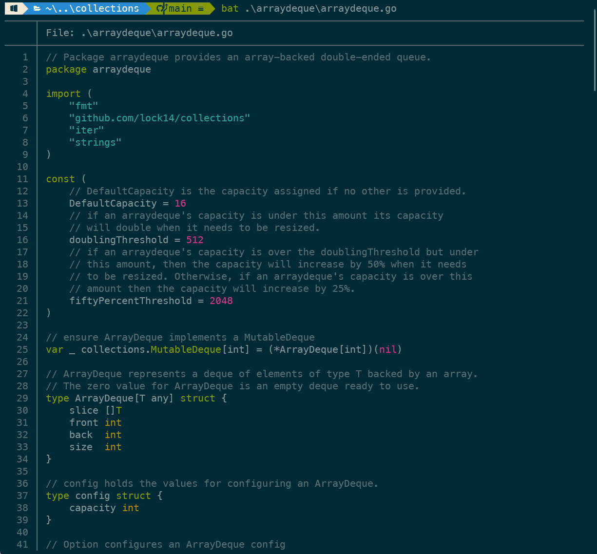

# windows-settings

[](https://github.com/lock14/windows-settings/actions/workflows/ci.yml)

Modern Windows developer workstation configuration, 17-theme TrueColor palette engine, cross-platform Zellij + Neovim RPC IDE & AI agent fleet manager, and setup automation for **PowerShell 7+**, **Zellij**, **Oh My Posh**, **Neovim**, **Command Prompt (`cmd.exe`)**, and **Windows Terminal**.

---

## Showcase

<p align="center">
  
  <br>
  <em>Oh My Posh Powerline prompt, predictive IntelliSense, and <code>eza</code> directory tree</em>
</p>

<p align="center">
  
  <br>
  <em>24-bit TrueColor syntax highlighting and Git gutter integration via <code>bat</code> (<code>b</code>)</em>
</p>

<p align="center">
  
  <br>
  <em>Modern Lua Neovim in Solarized Dark with Native LSP, <code>render-markdown.nvim</code>, and Tree-sitter AST highlighting</em>
</p>

---

## Architecture Overview

```text
windows-settings/
├── configuration.dsc.yaml         # WinGet DSC v3 declarative machine configuration
├── mise.toml                      # Declarative polyglot toolchains & CLI tools (Go, Java, Node, Python, Rust, Lean, CLI suite)
├── bootstrap.ps1                  # Turnkey zero-dependency one-liner bootstrapper
├── setup.ps1                      # Declarative master setup engine (-Theme, -Uninstall*, diff backup, -DryRun)
│
├── assets/                        # Showcase media and documentation diagrams
│
├── bin/                           # 7 dual-execution CLI utilities (.ps1 + .cmd):
│                                  #   gen-passwd, ide, install-nerd-fonts, repeat-until-success, sum, theme, update-system
│
├── config/                        # Unified declarative tool, theme & editor configurations
│   ├── bat/                       # 24-bit TrueColor bat themes & standalone Sublime syntaxes
│   │   ├── themes/                # 17 TrueColor .tmTheme palettes (9 classic + 8 US Holiday)
│   │   └── syntaxes/              # 37 standalone Sublime Text / bat syntax grammars
│   ├── btop/                      # btop4win config (btop.conf) & 17 TrueColor themes
│   ├── clangd/                    # C/C++ language server configuration (config.yaml)
│   ├── cmd/                       # Native cmd.exe AutoRun, Powerline shelf prompt & doskey macros (autorun.cmd)
│   ├── colors/                    # 40-language calibrated GNU dircolors (LS_COLORS)
│   ├── git/                       # TrueColor Git delta diff viewer config (delta.gitconfig)
│   ├── nvim/                      # Modern Lua Neovim 0.11+ / 0.12+ (Native LSP, Named Pipe RPC, :Theme)
│   │   ├── init.lua               # Native LSP, 17-theme engine, mini.files, render-markdown, IDE RPC
│   │   ├── lazy-lock.json         # Pinned Lazy.nvim plugin lockfile
│   │   ├── ftplugin/              # Per-filetype enhancements (java.lua)
│   │   ├── queries/               # 13 custom base Tree-sitter AST queries
│   │   └── after/queries/         # 30 Tree-sitter AST query extensions (43 .scm files total)
│   ├── powershell/                # PowerShell profile & Oh My Posh theme (p10k_single_line.omp.json)
│   ├── tealdeer/                  # Fast Rust tldr client configuration (config.toml)
│   ├── terminal/                  # Windows Terminal JSON fragment & settings (17 schemes + Alt+* pass-through)
│   ├── themes/                    # 17 canonical .theme palette specifications (9 classic + 8 US Holiday)
│   ├── vim/                       # Standalone zero-dependency 17-theme Vim configuration (_vimrc)
│   └── zellij/                    # Declarative Zellij 0.46+ config, Inverted-T layouts & TrueColor theme
│
├── module/                        # Autoloaded WindowsSettings PowerShell Module (<10ms startup)
│   ├── WindowsSettings.psd1       # Module manifest (v3.0.0 — 82 exported functions)
│   ├── WindowsSettings.psm1       # Root loader (theme sync, async PR badge cache, *.d/ drop-ins, FZF)
│   ├── Completions.ps1            # Native dynamic CLI completions
│   ├── Developer.ps1              # IDE RPC wrappers (v, icd, qide), theme & polyglot shortcuts
│   ├── Git.ps1                    # Git shortcuts & safety guards (gprune vs gpurge, gsync, guser-branch)
│   ├── Navigation.ps1             # Modern directory navigation & tree search (eza, ls, zoxide, fs)
│   └── Utilities.ps1              # Core shell utilities (b, ds, btop, update)
│
├── sample-code/                   # 40-language polyglot sample suite for syntax & AST query validation
│
└── tests/
    └── test_settings.ps1          # 219 automated tests across all 8 test modules
```

---

## Prerequisites

- **PowerShell 7+** (`pwsh`)
- **Git for Windows**
- **Windows Terminal**
- **winget** (Windows Package Manager, included in Windows 10/11)

---

## Quick Start

### 1. Turnkey Bootstrap (New Machines)

Stream and run directly in PowerShell 7 (`pwsh`) without pre-cloning:

```powershell
irm https://raw.githubusercontent.com/lock14/windows-settings/main/bootstrap.ps1 | iex
```

### 2. Declarative WinGet Configuration (Microsoft DSC v3)

Provision the complete workstation toolchain natively via Microsoft DSC:

```powershell
winget configure .\configuration.dsc.yaml
```

### 3. Automated Master Setup (Existing Clone)

```powershell
git clone https://github.com/lock14/windows-settings.git
cd windows-settings

# Full automated bootstrap
.\setup.ps1 -Bootstrap

# User dotfiles only with a specific initial palette (or -Theme holiday)
.\setup.ps1 -DotfilesOnly -Theme solarized-dark

# Preview actions without making system changes
.\setup.ps1 -DryRun

# Cleanly remove deployed dotfiles, module, fragments, fonts, and PATH entries
.\setup.ps1 -Uninstall
```

### 4. Command-Line Options (`setup.ps1` & `bootstrap.ps1`)

| Option | Default | Description |
| :--- | :--- | :--- |
| `-Bootstrap` | *disabled* | Full new machine bootstrap (packages, fonts, themes, prompt, module, terminal, nvim) |
| `-DotfilesOnly` | *disabled* | Configure user dotfiles, fonts, themes, nvim, terminal, and shell module only (no package install) |
| `-SystemOnly` | *disabled* | Provision winget packages and CLI tools only |
| `-UseDSC` | *disabled* | Provision workstation packages using declarative WinGet DSC manifest (`configuration.dsc.yaml`) |
| `-Theme <slug\|holiday>` | *current / `solarized-dark`* | Apply initial TrueColor theme across all tools (`solarized-dark`, `catppuccin-mocha`, `holiday`, etc.) |
| `-DryRun` | *disabled* | Preview setup or uninstall actions without modifying the system |
| `-WithGUI` / `-IncludeGUI` | *disabled* | Install GUI desktop applications (VS Code, Windows Terminal, Docker Desktop via winget) |
| `-Uninstall` | *disabled* | Cleanly remove all deployed dotfiles, module, terminal fragments, fonts, and `bin/` PATH entry |
| `-UninstallDotfiles` | *disabled* | Remove deployed dotfiles, PowerShell module, CMD AutoRun, and Windows Terminal fragment only |
| `-UninstallFonts` | *disabled* | Remove installed MesloLGS Nerd Font Mono files and registry entries only |
| `-UninstallBin` | *disabled* | Remove repository `bin/` directory from User `PATH` only |
| `-SkipPackages` | *disabled* | Skip winget package installation |
| `-SkipFonts` | *disabled* | Skip MesloLGS Nerd Font Mono installation |
| `-SkipPosh` | *disabled* | Skip Oh My Posh, Theme Engine & PowerShell module configuration |
| `-SkipCMD` | *disabled* | Skip Windows Command Prompt (`cmd.exe`) AutoRun & Doskey configuration |
| `-SkipCompletions` | *disabled* | Skip CLI argument completions registration |
| `-SkipTerminal` | *disabled* | Skip Windows Terminal settings & JSON fragment deployment |
| `-SkipVim` | *disabled* | Skip Neovim & Vim configuration |
| `-SkipBin` | *disabled* | Skip adding `bin/` directory to User `PATH` |

---

## What's Included

### 1. Multi-Theme TrueColor Engine (`theme` — 17 Built-in & US Holiday Palettes)
- Zero-dependency native PowerShell theme manager (`bin/theme.ps1` + `bin/theme.cmd`) synchronizing **17 built-in 24-bit TrueColor themes** plus custom user themes across **Zellij**, **Windows Terminal**, **Neovim** (live Named Pipe RPC), **Vim**, **PowerShell + PSReadLine**, **Oh My Posh**, **Command Prompt (`cmd.exe`)**, **`bat`**, **`delta`**, **`btop4win`**, **`tealdeer`**, **`fzf`**, **`eza`**, **`jq`**, and **`LS_COLORS`**:
  - **9 Classic Palettes**: `solarized-dark` *(default)*, `solarized-light`, `catppuccin-mocha`, `catppuccin-latte`, `gruvbox-dark`, `tokyonight-night`, `kanagawa-wave`, `nord`, `onedark`
  - **8 US Holiday Editions**: `new-years`, `valentines`, `st-patricks`, `easter`, `independence-day`, `halloween`, `thanksgiving`, `christmas`
- Common `theme` workflows:
  ```powershell
  theme                          # Interactive fzf picker with live TrueColor ANSI preview card
  theme --list                   # List all available themes with palette swatches
  theme catppuccin-mocha         # Instantly switch active theme across live terminal & Neovim sessions
  theme --holiday                # Auto-select today's US Holiday theme (falls back to default palette)
  theme --preview kanagawa-wave  # Render TrueColor swatch & sample syntax preview without switching
  theme --create my-theme --from nord
  ```

### 2. Hybrid Zellij + Neovim RPC IDE & Agent Fleet Manager (`ide`)
- Persistent multi-session IDE & AI coding agent fleet manager (`bin/ide.ps1` + `bin/ide.cmd`) powered by **Zellij 0.46+** (`config/zellij/`) and a live **Neovim Named Pipe RPC server** (`\\.\pipe\nvim-ide-<session>`), replicating the Linux `tmux` `home-settings` workflow natively on Windows (with `--backend wt` Windows Terminal fallback):
  - **`ide` / `ide3` (`--3pane`)**: Frameless Inverted-T layout beneath a 1-line `BASE02` `compact-bar` — Top-Left AI Agent (`agy`, `claude`, or `codex`), Top-Right Neovim Editor (`mini.files` + buffers), Bottom full-width PowerShell terminal.
  - **`ide2` (`--2pane`)**: Side-by-side AI Agent + Neovim Editor layout.
  - **Persistent Background Sessions & 1-Hop GPU Desktop Mode**:
    - `ide -d <dir>` spawns detached background agent sessions (`zellij attach --create-background`); `Ctrl+b d` detaches while keeping agents and Neovim alive.
    - `ide --desktop [dir]` launches Zellij's native 1-hop GPU desktop app (`zellij terminal`) with built-in OS System Tray icon and native desktop toast notifications.
  - **Native `OSC 7501` Attention Inbox**:
    - Tracks live agent state (`working`, `needs_you`, `done`, `failed`) across Claude Code, Codex, and Antigravity (`agy` via `~/.gemini/config/hooks.json`).
    - `Alt+s` / `Ctrl+b s` / `ide -s` opens Zellij's floating `session-manager` Attention Inbox; `Alt+Shift+S` / `Ctrl+b S` (`ide --next-attention`) jumps straight to the next agent needing input.
  - **Seamless Shell $\leftrightarrow$ Editor $\leftrightarrow$ Agent RPC**:
    - `v [+line] <file>` opens files directly inside the live IDE Neovim pane instead of nesting editors.
    - `icd <dir>` (and `:IdeCd` inside Neovim) synchronizes the workspace root across both shell and editor.
    - `<leader>a` in Neovim Visual mode (or `ide --send`) bracket-pastes `@file#L10-L25` references directly into the live AI pane (`zellij action paste -p`).
    - `Alt+a` / `Alt+e` / `Alt+t` jump directly to AI / Editor / Shell panes (`Alt+;` or Normal `<leader>a` bounces back); `Alt+h/j/k/l`, `Alt+Arrows`, and `Alt+z` navigate, resize, and zoom panes.
    - `:Q`, `Alt+q`, `qide`, and `quit` (`ide --quit`) check all Neovim buffers for unsaved changes before closing the session (`idek` / `ide --kill` force-closes).

### 3. Single-Line Powerlevel10k Prompt (`config/powershell/p10k_single_line.omp.json`)
- Flawless dynamic Powerline transitions powered by **Oh My Posh** on the active theme's **`BASE02` shelf** (`#073642` in Solarized Dark).
- **Calm OS & Holiday Glyph**: Displays the Windows glyph in calm `BASE0` (`#839496`), automatically shifting to seasonal holiday icons when a US Holiday theme is active.
- **Async Clickable `<branch>@<N>` PR Badges**: Background non-blocking `gh` / `glab` lookup renders clickable OSC 8 Pull Request hyperlinks right next to the Git branch without adding prompt latency.
- **Persistent Right Status Anchor**: Displays `` in Green on success or `` in Red on error alongside execution duration (``), active toolchains (Node, Go, Python, .NET, Rust), and AWS context.
- **High-Speed Disk Caching**: Compiles prompt initialization into `$HOME\.cache\powershell\omp_init.ps1` for `<10ms` shell startup.

### 4. First-Class PowerShell Module (`WindowsSettings`) & Local Drop-In Hooks
- Clean autoloaded PowerShell Module (`$HOME\Documents\PowerShell\Modules\WindowsSettings`) imported via a 1-line `$PROFILE`:
  ```powershell
  Import-Module WindowsSettings -DisableNameChecking -ErrorAction SilentlyContinue
  ```
- **Untracked Local Customization (`*.d/`)**: Automatically sources machine-local scripts from `$HOME\.config\windows-settings\{env,aliases,functions}.d\*.ps1` without touching tracked files.

### 5. Windows Command Prompt (`cmd.exe`) AutoRun & Doskey
- Zero-dependency `cmd.exe` parity via `config/cmd/autorun.cmd` registered in `HKCU\Software\Microsoft\Command Processor\AutoRun`.
- **Dynamic Theme Sync & Drop-Ins**: Loads UTF-8 (`chcp 65001`), `COLORTERM=truecolor`, `FORCE_HYPERLINK=1`, `JQ_COLORS`, generated `theme_env.cmd`, and `$HOME\.config\windows-settings\cmd.d\*.cmd` hooks with 0ms external process overhead.
- **Complete Doskey Parity**: Mirrors `b=bat`, `ds=dust`, `btop`, `theme`, `update`, `ide`/`ide2`/`ide3`/`idek`/`qide`/`quit`, `v`, `icd`, `ls`/`eza` variants, and Git shortcuts.

### 6. Modern Rust & Polyglot CLI Developer Toolchain
- **`bat` (`b`) & Raw `uutils` `cat`**: `b` launches `bat` with 17 custom `.tmTheme` palettes, 37 standalone `.sublime-syntax` grammars, Git gutter markers, and italic comments, while `cat` runs native `uutils-coreutils` `cat` with zero decoration surprises.
- **`delta`**: Syntax-highlighted TrueColor Git diffs (`config/git/delta.gitconfig`) automatically wired into global `.gitconfig` and synced by `theme`.
- **`eza` & `LS_COLORS`**: 83-code 24-bit TrueColor `EZA_COLORS` (`e`, `el`, `elm`, `et`, `elt`, `elx`) and 40-language calibrated `LS_COLORS` (`ls`, `ll`, `la`, `l`).
- **`dust` (`ds`), `sd`, `yq`, `jq`, `tealdeer` (`tldr`), `btop4win` (`btop`), `glow`, `zoxide` (`z`), `fzf`**: Declaratively provisioned via `configuration.dsc.yaml` and `mise.toml`.
- **Native `bin/` Utilities**: Dual-execution (`.ps1` + `.cmd`) scripts for `theme`, `ide`, `update-system` (`update`), `sum`, `gen-passwd`, `repeat-until-success`, and `install-nerd-fonts`.

### 7. Git, IDE & Developer Shortcuts

| Shortcut | Description |
| :--- | :--- |
| `Ctrl+R` | Interactive fuzzy search command history via `fzf` (with graceful PSReadLine fallback) |
| `z <dir>` | Smart frecency jump to directory via `zoxide` |
| `b <file>` | Syntax-highlighted file viewing with Git gutter via `bat` |
| `cat <file>` | Fast raw file concatenation via `uutils-coreutils` `cat` |
| `theme [slug]` | Interactive `fzf` theme picker or instant 17-theme palette switch (`--list`, `--holiday`, `--preview`) |
| `ide` / `ide3` / `ide2` | Launch or attach 3-pane Inverted-T or 2-pane Zellij + Neovim RPC + AI IDE session (`-d` detach, `--desktop` GPU app) |
| `ide -s` / `Alt+s` | Open Zellij floating Session Manager & `OSC 7501` Agent Attention Inbox (`Alt+Shift+S` jumps to next attention) |
| `v [+line] <file>` | Open file in active IDE Neovim pane via Named Pipe RPC (falls back to local `nvim`) |
| `icd [dir]` | Synchronized directory jump across current shell and active IDE Neovim server (`icd ~` resets root) |
| `qide` / `quit` / `idek` | Safely quit IDE workspace after checking unsaved Neovim buffers (`idek` force-kills) |
| `ds` | Visual disk usage tree via `dust` |
| `btop` | Interactive TrueColor system monitor (`btop4win`) |
| `update` | Unified workstation updater (`winget`, `mise`, PowerShell modules, `nvim` Lazy plugins, `tldr`) |
| `gco` / `gcb` / `gcm` | `git checkout` / `git checkout -b` / `git checkout main` (or `master`) |
| `ga` / `gaa` | `git add` / `git add --all` |
| `gst` / `gss` | `git status` / `git status -s` |
| `gd` / `gds` | `git diff` / `git diff --staged` (rendered via `delta`) |
| `gl` / `gp` | `git pull --rebase --autostash` / `git push` (auto-sets `-u origin HEAD` on new branches) |
| `gb` / `gba` / `gbd` | `git branch` (list / all / safe delete `-d`) |
| `gsta` / `gstp` / `gstl` | `git stash` (push / pop / list) |
| `glog` / `glo` | `git log --graph` / `git log --oneline` |
| `grb` / `grbc` / `grba` | `git rebase` / `--continue` / `--abort` |
| `gcommit` / `gamend` | `git add -A && git commit` / `git add -A && git commit --amend --no-edit` |
| `gup` | `git fetch --prune && git pull --rebase --autostash` |
| `gprune` / `gpurge` | Delete **merged** local branches safely (`gprune`) vs force-delete unmerged branches (`gpurge`) |
| `gsync` | Guarded rebase of clean working tree onto latest `origin/main` or `origin/master` |
| `guser-branch` | Prefix feature branch with `$USER/` (blocks renaming `main`/`master`, strips duplicate prefixes) |
| `go-testall` / `go-buildall` / `go-lint` | `go test ./...` / `go build ./...` / `golangci-lint run` |
| `tf` / `yaml-lint` | `terraform` / `yamllint` |
| `vi` / `vim` | `nvim` (with automatic fallback to `vim`) |
| `ls` / `ll` / `la` / `l` | Coreutils directory listings rendered with unbolded TrueColor `LS_COLORS` |
| `e` / `el` / `elm` / `et` / `elt` / `elx` | Modern `eza` listings with Git status, `--group`, `--time-style=long-iso`, and tree views |
| `fs` | Fast recursive directory tree search (`fd` + `Format-PathTree`) |

### 8. Modern Lua Neovim (`config/nvim/init.lua`) & Standalone Vim (`config/vim/_vimrc`)
- **Neovim 0.11+ / 0.12+ Native LSP**: Configured via `vim.lsp.config` / `vim.lsp.enable` across Go (`gopls`), Python (`pyright`), TypeScript (`ts_ls`), Rust (`rust_analyzer`), C/C++ (`clangd`), Terraform (`terraformls`), YAML (`yamlls`), Lean 4 (`leanls`), and Java (`ftplugin/java.lua`).
- **43 Custom Tree-sitter AST Queries**: 13 base query supersedures (`queries/`) and 30 runtime extensions (`after/queries/`) calibrated across the 40-language polyglot validation suite (`sample-code/`).
- **Rich In-Buffer UX**: `render-markdown.nvim` terminal Markdown rendering, `mini.files` + `mini.icons` explorer (`-`), AST link/heading navigation (`gx`, `]]`, `[[`, `gO`), mouse back/forward (`<X1Mouse>`/`<X2Mouse>`), Telescope (`<leader>ff`, `<leader>fg`), and live `:Theme <slug>` switching.
- **Zero-Dependency Fallback Vim (`_vimrc`)**: Self-contained 17-theme TrueColor/256-color engine with `:Theme` command for environments without Neovim.

### 9. Zero-Touch Windows Terminal (`config/terminal/`)
- Native Windows Terminal JSON Fragment extension (`config/terminal/windows-settings.json`) deploying all **17 TrueColor schemes**, **MesloLGS Nerd Font Mono**, and clean **`Alt+*` pass-through** so Zellij workspace/session/attention keybindings operate without host terminal collisions.

---

## Testing & Quality Gates

Run static analysis and the automated validation suite locally:

```powershell
Invoke-ScriptAnalyzer -Path . -Recurse -Settings ./PSScriptAnalyzerSettings.psd1
$null | pwsh -NoProfile -File ./tests/test_settings.ps1
```

Runs **219 automated tests across all 8 modules**:
1. PowerShell Script & Module Syntax
2. JSON, KDL, YAML, Theme, Query & Manifest Validity (`configuration.dsc.yaml`, `mise.toml`, `config/zellij/`, `p10k_single_line.omp.json`, `settings.json`, fragments, 17 `.theme` & `.tmTheme` files, 37 `bat` syntaxes, 43 `.scm` queries, `delta`, `tealdeer`, `clangd`, `btop`)
3. WindowsSettings Module Import, Aliases & Function Exports (82 functions)
4. Native CLI Utilities & Pipeline Handling (`sum`, `gen-passwd`, `repeat-until-success`, `theme`, `ide`, `update-system`)
5. Git Workflow Behavior & Safety Guards (`gsync`, `gprune`, `gpurge`, `guser-branch`, `fix-abcxyz-branch-name`)
6. Completions, CMD AutoRun & Prompt Rendering (including OSC 8 PR badge hyperlinks)
7. Path Invariants & Dual Execution Wrappers (all 7 `.ps1` + `.cmd` pairs in `bin/`)
8. Setup Script Idempotency, DryRun, `-Theme`, Clean `-Uninstall*` & Backup Policy
